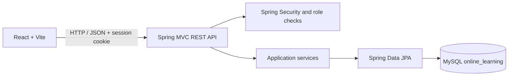

# Online Learning Platform

A web-based learning platform built with React, Spring MVC, Spring Security,
Spring Data JPA, and MySQL. Students can browse courses, enroll, track course
progress, and take quizzes. Instructors manage their courses and quizzes, while
administrators manage accounts, course assignments, and catalog categories.

The active application is under `OnlineLearningPlatform/`. The earlier starter
project at the repository root (`backend/`, `frontend/`, and `database/`) is
retained; GitHub Pages deploys the frontend from the active application.

> **Implementation status:** This README describes the complete project goal
> and identifies which features are implemented in the current codebase.
> Lesson delivery, lesson-level progress, course search and filters, profile
> management, course publication and approval, quiz explanations and pass
> requirements, and completion certificates remain planned work; they are not
> included in the current application.

## Table of contents

- [Project goals](#project-goals)
- [Technology and architecture](#technology-and-architecture)
- [Features and implementation status](#features-and-implementation-status)
- [Pages and navigation](#pages-and-navigation)
- [Database design](#database-design)
- [API overview](#api-overview)
- [Security and authorization](#security-and-authorization)
- [Project structure](#project-structure)
- [Setup and run](#setup-and-run)
- [Tests](#tests)
- [Recommended development roadmap](#recommended-development-roadmap)

## Project goals

The application demonstrates how a modern frontend, REST backend, and
relational database work together:

1. React presents pages, forms, course cards, dashboards, and quizzes.
2. Spring MVC exposes JSON endpoints and applies validation and business rules.
3. Spring Security authenticates users and restricts role-protected operations.
4. Spring Data JPA persists application data in MySQL.

The target student journey is:

**Register → browse and search courses → inspect course details and curriculum
→ enroll → study lessons → take quizzes → track progress → earn a certificate.**

The current application supports registration, course browsing and details,
enrollment, course-level progress, quiz attempts, and role-specific dashboards.
The lesson, search/filter, profile, and certificate steps are roadmap items.

## Technology and architecture

| Layer | Technology | Responsibility |
|---|---|---|
| Frontend | React, Vite, JavaScript, CSS | Responsive pages and user interactions |
| Backend | Java 21, Spring Boot, Spring MVC | REST API, validation, application logic |
| Persistence | Spring Data JPA, Hibernate | Database access and entity mapping |
| Security | Spring Security, BCrypt, server-side sessions, CSRF | Authentication and endpoint authorization |
| Database | MySQL | Accounts, courses, enrollments, progress, quizzes, results |



The frontend and backend run as separate applications. The frontend calls the
backend at `http://localhost:8080` by default. Set `VITE_API_BASE_URL` when the
backend uses a different address.

## Features and implementation status

### Student

| Feature | Current status |
|---|---|
| Register with name, email, and password | Implemented; duplicate email is rejected |
| Confirm password and show/hide password controls | Implemented in the registration/sign-in UI |
| Secure sign-in and sign-out | Implemented with BCrypt password hashes and server-side sessions |
| Forgot password with email reset link | Implemented; requires SMTP configuration; links expire after 30 minutes and are single-use |
| Role-based navigation and protected backend endpoints | Implemented |
| Browse course catalog and view course details | Implemented |
| Course title, description, and instructor in catalog | Implemented |
| Search by course name or keyword | Planned |
| Filter by category | Category data and management exist; student catalog filtering is planned |
| Difficulty level, course thumbnail, and curriculum preview | Planned |
| Enroll in courses and view enrolled courses | Implemented; duplicate enrollment is prevented |
| Course-level progress and completion action | Implemented |
| Ordered lessons, video links, notes, and downloadable resources | Planned |
| Lesson completion and resume from last lesson | Planned |
| Multiple-choice quizzes, server-side scoring, and retake history | Implemented |
| Quiz passing score and answer explanations | Planned |
| Dashboard enrollment, completion, progress, and quiz history | Implemented |
| Profile and password management | Planned |
| Printable completion certificates | Optional future feature |

### Instructor

| Feature | Current status |
|---|---|
| Role-specific instructor dashboard | Implemented |
| Create, edit, and delete owned courses | Implemented |
| Assign a course category | Implemented |
| Course difficulty, thumbnail, and publish/unpublish workflow | Planned |
| Create multiple-choice quizzes for an owned course | Implemented |
| Manage lessons, video URLs, notes, and downloadable materials | Planned |
| View course enrollment counts | Implemented |
| View enrolled student details and quiz-performance analytics | Planned |

### Administrator

| Feature | Current status |
|---|---|
| Role-specific dashboard with student, instructor, admin, and course totals | Implemented |
| Search accounts and update their roles | Implemented |
| Search courses, see each course's actual enrollment count, and assign instructors | Implemented |
| Create courses and add quizzes with questions and answer options | Implemented |
| Manage course categories | Implemented |
| Delete courses with no enrollments | Implemented |
| Edit or deactivate user accounts | Planned |
| Instructor application and approval workflow | Planned |
| Review and publish submitted courses | Planned |
| Platform enrollment statistics and activity feed | Planned |

Admin access is assigned to authorized accounts; registration always creates a
student. The **Admin sign in** page at `/admin/login` uses the normal secure
authentication service and rejects accounts without the `ADMIN` role. It does
not grant administrator access.

## Pages and navigation

The navigation adapts to the signed-in user's role. Available pages and views
include:

| Page or view | Purpose | Status |
|---|---|---|
| Home / Courses | Welcome banner and public course catalog | Implemented |
| Course details | Course description and enrollment action | Implemented |
| Register | Create a student account | Implemented |
| Login | Sign in to an existing account | Implemented |
| Forgot/reset password | Request an email link and choose a new password | Implemented; SMTP setup required |
| Admin login | Dedicated administrator sign-in entry point | Implemented |
| My Learning / Student dashboard | Enrolled courses, progress, quiz history | Implemented |
| Instructor dashboard | Instructor course and quiz management | Implemented |
| Admin dashboard | Overview, users, courses, categories in a left sidebar | Implemented |
| Course search and filters | Find courses by name, keyword, and category | Planned |
| Lesson player | Follow ordered course lessons and resume learning | Planned |
| Profile | View and update account details or password | Planned |
| Certificate | View and print an earned completion certificate | Optional |

Suggested full navigation as the roadmap is completed:

`Home | Courses | My Learning | Dashboard | Profile`

Role-specific dashboard links should remain visible only to the appropriate
signed-in role. Authorization must also be enforced by Spring Security and
backend service/controller checks, not just by hiding frontend links.

## Database design

The startup scripts in `OnlineLearningPlatform/database/` are idempotent and
preserve existing records. The current schema includes:

| Current table | Purpose |
|---|---|
| `users` | Account name, unique email, BCrypt password hash, and role |
| `password_reset_tokens` | SHA-256 token hashes, account id, expiry, and one-time-use timestamp |
| `courses` | Course title, description, and instructor display name |
| `enrollments` | Student/course relationship and enrollment timestamp; a unique constraint prevents duplicate enrollment |
| `learning_progress` | Course-level progress percentage for a student |
| `quizzes` | Quiz title and associated course |
| `quiz_questions` | Ordered quiz questions |
| `quiz_options` | Ordered answer choices and correctness flags |
| `quiz_attempts` | Student quiz score, question count, and attempt timestamp |
| `course_instructors` | Instructor ownership/assignment for a course |
| `course_categories` | Course category names |
| `course_category_assignments` | Course/category relationship |

### Recommended lesson and completion tables

Lesson delivery and lesson-level progress are not yet present in the current
schema. A future migration can add tables such as:

| Proposed table | Important fields | Purpose |
|---|---|---|
| `lessons` | `lesson_id`, `course_id`, `title`, `sequence_no`, `video_url`, `notes`, `resource_url` | Ordered course content and learning materials |
| `lesson_progress` | `user_id`, `lesson_id`, `completed`, `completed_at`, `last_viewed_at` | Completion and resume tracking |
| `certificates` | `certificate_id`, `user_id`, `course_id`, `completed_at` | Optional printable achievement records |

Use primary and foreign keys for relationships, a unique constraint on user
email, and a unique constraint on `(user_id, course_id)` enrollments. Add indexes
for frequently searched course/category fields as search and filtering are
implemented. Store only password hashes, never raw passwords.

The current schema is created by these startup scripts:

1. `OnlineLearningPlatform/database/schema.sql`
2. `OnlineLearningPlatform/database/sample_data.sql`
3. `OnlineLearningPlatform/database/quiz_schema.sql`

## API overview

The following endpoints are implemented in the current backend:

| Method | Endpoint | Purpose |
|---|---|---|
| `GET` | `/api/courses` | Public course catalog |
| `GET` | `/api/courses/{courseId}` | Course details |
| `GET` | `/api/categories` | Course categories |
| `GET` | `/api/auth/csrf` | Initialize a CSRF-protected session |
| `POST` | `/api/auth/register` | Register a student account |
| `POST` | `/api/auth/login` | Sign in |
| `GET` | `/api/auth/me` | Get current signed-in account |
| `POST` | `/api/auth/logout` | Sign out |
| `POST` | `/api/auth/password/forgot` | Send a password-reset link if the account email exists |
| `POST` | `/api/auth/password/reset` | Set a new password with a valid one-time reset token |
| `POST` | `/api/enrollments/{courseId}` | Enroll current student |
| `GET` | `/api/dashboard` | Current student's enrolled courses and progress |
| `PUT` | `/api/enrollments/{courseId}/progress` | Update course progress |
| `GET` | `/api/courses/{courseId}/quizzes` | Get quizzes for an enrolled student |
| `POST` | `/api/quizzes/{quizId}/attempts` | Submit answers and save a score |
| `GET` | `/api/quiz-attempts` | Current student's quiz history |
| `GET` | `/api/instructor/dashboard` | Instructor-owned courses and enrollment counts |
| `POST` | `/api/instructor/courses` | Create an instructor-owned course |
| `PUT` / `DELETE` | `/api/instructor/courses/{courseId}` | Update or delete an owned course |
| `POST` | `/api/instructor/courses/{courseId}/quizzes` | Create a quiz for an owned course |
| `GET` | `/api/admin/dashboard` | Platform user/course statistics |
| `GET` | `/api/admin/users` | List accounts |
| `PUT` | `/api/admin/users/{userId}/role` | Update a user's role |
| `GET` | `/api/admin/courses` | List courses and instructor assignments |
| `POST` | `/api/admin/courses` | Create a course |
| `PUT` | `/api/admin/courses/{courseId}/instructor` | Assign an instructor to a course |
| `POST` | `/api/admin/courses/{courseId}/quizzes` | Create a quiz with questions and answer options |
| `DELETE` | `/api/admin/courses/{courseId}` | Delete an unenrolled course |
| `GET` / `POST` | `/api/admin/categories` | List or add categories |
| `DELETE` | `/api/admin/categories/{categoryId}` | Delete a category |

Lesson, profile, certificate, course-search/filter, and course-publication
endpoints belong to the roadmap and are not implemented yet.

## Security and authorization

- Passwords are hashed with BCrypt by Spring Security.
- Passwords are not stored in plain text or placed in source control.
- Registration validates the name, email, and password and rejects duplicate
  email addresses.
- The frontend requires a password confirmation during registration.
- Authentication uses server-side sessions and CSRF protection.
- Authenticated requests include the session cookie and CSRF token.
- Password reset tokens are random, time-limited, single-use, and stored as
  SHA-256 hashes. Reset requests use a generic response to avoid confirming
  whether an email address has an account.
- Student enrollment and quiz endpoints act on the authenticated account.
- Instructor operations are restricted to instructor-owned courses.
- Admin endpoints require the `ADMIN` role on the backend.
- The dedicated admin login UI checks the role returned by the backend and
  signs out non-admin accounts.
- Never rely on frontend visibility alone to protect data or operations.

### Bootstrap the first administrator

Register the intended account through the site. Then, using a trusted local
MySQL administrator connection, promote that account:

```sql
USE online_learning;
UPDATE users
SET role = 'ADMIN'
WHERE email = 'allurivyshwika@gmail.com';
```

Replace the example address with the registered account's email. Sign out and
sign back in at `/admin/login` so the new role is loaded into the session.
An administrator can then promote accounts to `INSTRUCTOR` from the admin
dashboard. Do not share database credentials or commit them to the repository.

## Project structure

```text
OnlineLearningPlatform/
├── database/
│   ├── schema.sql
│   ├── sample_data.sql
│   └── quiz_schema.sql
├── backend/
│   ├── pom.xml
│   └── src/
│       ├── main/
│       │   ├── java/com/learning/backend/
│       │   │   ├── config/
│       │   │   ├── controller/
│       │   │   ├── dto/
│       │   │   ├── model/
│       │   │   ├── repository/
│       │   │   └── service/
│       │   └── resources/application.properties
│       └── test/
└── frontend/
    ├── package.json
    └── src/
        ├── App.jsx
        ├── api.js
        ├── components/
        └── styles.css
```

## Setup and run

### Prerequisites

- Java 21 or later
- Node.js and npm
- MySQL Server and MySQL Workbench (or a MySQL command-line client)
- VS Code or another IDE

The backend Maven wrapper is included; a global Maven installation is not
required.

### Database

Create or use the local MySQL database named `online_learning`. On backend
startup, the idempotent SQL scripts run and Hibernate validates the schema.
Existing course and account data is intended to be preserved.

You can inspect the database in MySQL Workbench:

```sql
USE online_learning;
SHOW TABLES;
SELECT course_id, title, instructor FROM courses;
```

### Start the Spring backend

Configure SMTP in the same PowerShell terminal used to start the backend.
For Gmail, enable 2-Step Verification and create an app password (not your
regular Gmail password); other providers can use their SMTP host and
credentials. Do not paste credentials into source files or commit them:

```powershell
$secure = Read-Host "MySQL password" -AsSecureString
$env:DB_PASSWORD = [System.Net.NetworkCredential]::new("", $secure).Password
$env:MAIL_HOST = "smtp.gmail.com"
$env:MAIL_PORT = "587"
$env:MAIL_USERNAME = "your-email@gmail.com"
$mailSecure = Read-Host "SMTP app password" -AsSecureString
$env:MAIL_PASSWORD = [System.Net.NetworkCredential]::new("", $mailSecure).Password
$env:MAIL_FROM = $env:MAIL_USERNAME
cd OnlineLearningPlatform\backend
.\mvnw.cmd spring-boot:run
```

Keep the terminal open. The backend normally runs at `http://localhost:8080`.
Look for a startup message confirming Tomcat is listening on port `8080`.
Email password-reset links will not send until valid SMTP settings are set and
the backend has been restarted.

### Start the React frontend

Open a second terminal:

```powershell
cd OnlineLearningPlatform\frontend
npm install
npm run dev
```

Open the Vite URL, normally `http://localhost:5173`, and keep this terminal
open while using the website.

## Tests

Run backend tests:

```powershell
cd OnlineLearningPlatform\backend
.\mvnw.cmd test
```

Create a production frontend build:

```powershell
cd OnlineLearningPlatform\frontend
npm run build
```

## Deploy the frontend with GitHub Pages

The GitHub Actions workflow builds and publishes the React frontend from
`OnlineLearningPlatform/frontend/` when frontend files are pushed to `main`.
The Vite configuration supports the repository's Pages subpath, and a
not-found fallback keeps the app's client-side login routes available.

The repository is public. Before the first deployment, an account with
repository admin access must enable Pages under **Settings → Pages** and choose
**GitHub Actions** as the build and deployment source. The workflow cannot
create the Pages site because GitHub does not grant that permission to its
Actions token.

This deployment hosts only the frontend. The Spring Boot API and MySQL database
are not hosted by GitHub Pages, so course loading, registration, login,
enrollment, quizzes, and password reset will not work until the backend and
database are deployed separately. Once the API is hosted over HTTPS, add a
repository Actions variable named `VITE_API_BASE_URL` with its base URL and
rerun the workflow. Email password reset will also require SMTP environment
variables on the backend host.

After a successful deployment, the frontend will be available at:
`https://allurivyshwika.github.io/OnlinelearningPlatform_fsd/`

## Recommended development roadmap

The following sequence completes the broader student and content-management
requirements:

1. **Catalog discovery:** add course difficulty and thumbnail fields; implement
   keyword search and category filters in the React catalog and backend API.
2. **Course curriculum:** add ordered lessons, YouTube or other permitted video
   links, notes, and downloadable learning materials.
3. **Lesson progress:** enforce enrollment before lesson access; track lesson
   completion and the last viewed lesson; add a “Continue learning” action.
4. **Quiz review:** configure passing scores and return correct answers and
   explanations after submission while keeping grading on the server.
5. **Instructor content workflow:** support lesson management, course drafts,
   publish/unpublish actions, enrollment lists, and performance summaries.
6. **Admin oversight:** add account editing/deactivation, instructor approval,
   course review and publication, enrollment statistics, and platform activity.
7. **Profile and certificates:** allow safe profile/password updates and
   optionally issue printable certificates after completion requirements pass.
8. **Polish and verification:** test role permissions, responsive layouts,
   duplicate enrollment, validation failures, empty/loading/error states, and
   the full student journey.

Avoid adding payments, live classes, real-time chat, or an AI assistant until
the student course journey and role workflows are complete and tested.

## Demo checklist

1. Browse the public catalog and inspect a course.
2. Register a student account and sign in.
3. Enroll in a course; verify it appears in My Learning.
4. Take a quiz; verify the score appears in quiz history.
5. Use the role-appropriate instructor dashboard to manage an owned course.
6. Sign in at `/admin/login` with an administrator account; review the sidebar,
   platform overview, user roles, course assignments, and categories.
7. Sign out and verify that the public course catalog remains available.
